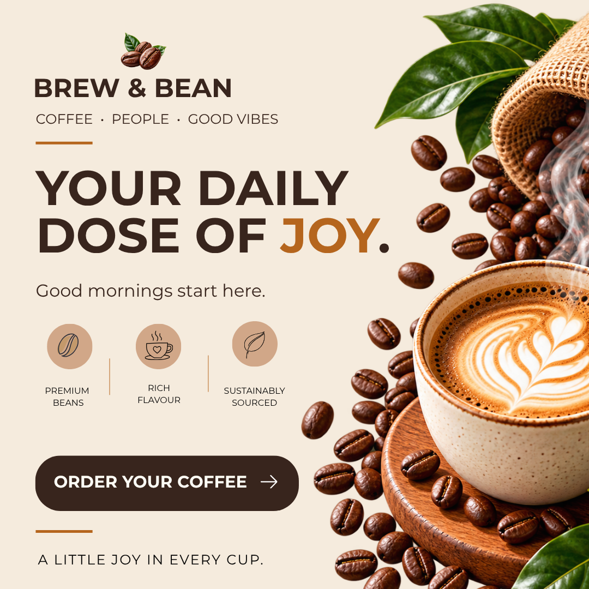

# Brew & Bean | Coffee Social Media Advertisement

A premium coffee advertising design that celebrates the joy of coffee through warm tones, refined typography, and rich product imagery.

## Design Preview

## Brand Overview

Brew & Bean brings together quality coffee, inviting aesthetics, and a welcoming brand experience. The visual direction reflects the warmth and richness of coffee while maintaining a clean, contemporary appearance.

The campaign headline, **“Your Daily Dose of Joy,”** communicates the comfort and happiness associated with an everyday coffee ritual.

## Creative Direction

The design combines a warm, minimal background with bold typography and detailed coffee imagery to create a premium, approachable advertising aesthetic.

Key creative priorities include:

- Establishing a strong visual hierarchy.
- Creating contrast between the headline and background.
- Highlighting the coffee product through expressive imagery.
- Maintaining balance between typography, imagery, and whitespace.
- Using a clear call to action to encourage customer engagement.

## Visual Identity

| Element | Specification |
|---|---|
| Primary background | Warm cream / beige |
| Primary typography | Deep coffee brown |
| Accent color | Caramel brown |
| Typography style | Bold, modern, and legible |
| Product imagery | Latte art, roasted coffee beans, and coffee leaves |
| Brand attributes | Warm, premium, inviting, contemporary |

## Design Highlights

**Typography and hierarchy**  
A prominent headline establishes the main message, supported by concise copy and clearly differentiated text elements.

**Color palette**  
Cream, deep brown, and caramel create a cohesive palette inspired by coffee and natural ingredients.

**Product presentation**  
Latte art and roasted coffee beans reinforce product appeal and establish an immediate visual connection to the coffee category.

**Call to action**  
The “Order Your Coffee” element provides a clear focal point for the promotional message.

**Composition and balance**  
The layout balances text and product imagery while preserving readability and visual clarity.

## Tools Used

- **Canva** — visual design, layout, typography, and color composition
- **PNG** — final design export format
- **GitHub** — project files and documentation

## Project Information

- **Brand:** Brew & Bean
- **Category:** Coffee and beverages
- **Deliverable:** Social media advertisement
- **Creative theme:** Everyday coffee moments
- **Campaign headline:** Your Daily Dose of Joy

---

**Brew & Bean — Coffee. People. Good Vibes.**
